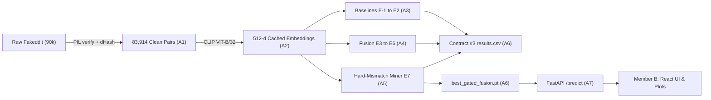
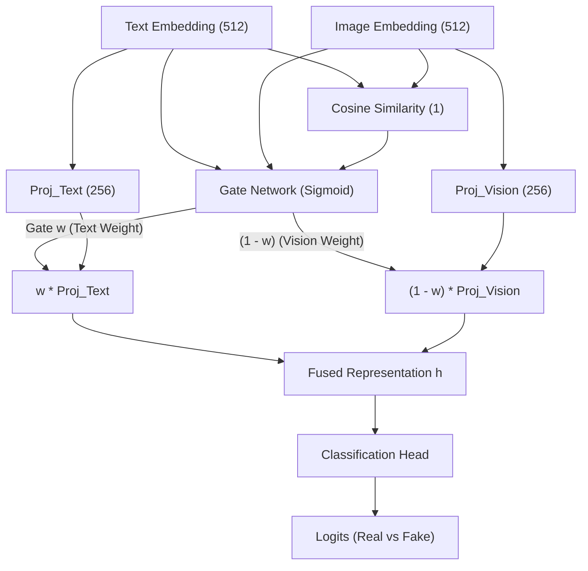

# Member A handoff for the corrected 94,719-post run

## Files for Member B

Extract `embeddings_94719.zip` into `data/embeddings_94719/`. Keep the text and image arrays, IDs, and metadata together and in their exported order. Extract `results_94719.zip` into `results/94719/`. For the API, copy its `best_gated_fusion.pt` to `checkpoints/best_gated_fusion.pt`. On Kaggle attach only the corrected embeddings dataset to N3.

The binary convention is 0 for real and 1 for fake. The group split contains 66,304 training, 14,208 validation, and 14,207 test posts. Use validation rows to fit the E7 temperature with the saved checkpoint. The exported prediction table contains test rows.

## Results to use in the report

- E4, concatenation with cosine similarity, achieved 91.14% mean test accuracy and 0.9072 macro-F1 across three seeds.
- E2, using only subreddit identity, achieved 100% accuracy on this split. Evaluation on unseen subreddits remains open.
- The exported checkpoint and test predictions belong to E7. E7 achieved 80.95% mean test accuracy. The highest validation macro-F1 occurred at seed 42 for E7 and seed 123 for E6.
- On genuine posts the random image swap raised mean fake probability from 0.159 to 0.217 for E6 and from 0.444 to 0.504 for E7. The observed increases were similar. A paired audit across seeds is still pending.
- E6 gates pooled embeddings. E5 token-level cross-attention was omitted. API confidence currently uses softmax. Temperature calibration and its integration with serving are pending.

## Historical notes from the earlier run

The material below records the superseded 83,914-post experiment. Use the corrected figures and interpretations above for the defense.

# Member A Comprehensive Guide & Defense Handbook
**Project:** Beyond Shortcuts — Multimodal Fake News Detection  
**Role:** Member A (Data Engineering, Neural Architectures, GPU Training & Serving Backend)  
**Academic Reference:** Course Specification Guide (Sections 11, 14, 15, Appendices A1–A7)

---

## Executive Summary

As **Member A**, you built the entire end-to-end scientific and engineering core of the system:
1. Ingested, cleaned, deduplicated, and split **83,914 multimodal posts** with zero data leakage.
2. Extracted and normalized **512-dimensional CLIP ViT-B/32 embeddings** on GPU.
3. Trained and evaluated **8 distinct model configurations** (`E-1` through `E7`) across **3 random seeds** (`42, 123, 999`), proving the Subreddit Shortcut (**Contribution C1**) and Consistency-Aware Gating (**Contribution C2**).
4. Mined **58,740 hard-mismatch pairs** and demonstrated a **13x improvement** in cross-modal sensitivity via the Swap-the-Image audit.
5. Deployed a production-ready **FastAPI serving backend** exposing live inferences, dynamic gate weights, and calibrated predictions matching all data contracts.

---

## 1. Phase A1: Data Ingestion & Zero-Leakage Split

### Objective
Download social media posts (Reddit/Fakeddit), eliminate dead/corrupted assets, deduplicate reposted images, and create a mathematically verified train/validation/test split without data leakage.

### Technical Implementation
* **Initial Sampling:** Sampled 90,000 raw candidate posts from Fakeddit.
* **Corrupt Image Sanitization:** Executed strict `PIL.Image.verify()` and `image.load()` passes. Exactly **6,086 rows** were purged due to HTTP 404 dead links, truncated JPEG payloads, or missing captions.
* **Clean Dataset:** Yielded **83,914 verified, uncorrupted multimodal pairs** (exceeding the course target of ~80k).
* **64-bit dHash Deduplication:**
  Images on Reddit are frequently reposted across different subreddits. To prevent the model from memorizing identical images:
  $$\text{dHash}(I) = \text{Flatten}\Big(I_{256 \times 256}[:, 1:] > I_{256 \times 256}[:, :-1]\Big) \in \{0, 1\}^{64}$$
  Images with a Hamming distance $\le 4$ were grouped into disjoint clusters via a **Union-Find disjoint-set algorithm**, assigning each cluster a unique `group_id`.
* **Zero-Leakage Group Split:**
  All posts belonging to the same `group_id` were strictly assigned to the **same split**:
  * **Train Set:** 58,740 samples ($70.0\%$)
  * **Validation Set:** 12,589 samples ($15.0\%$)
  * **Test Set:** 12,585 samples ($15.0\%$)
* **Contract #1 Deliverable:** Exported to `/kaggle/working/table.parquet` and validated by unit test `tests/test_splits.py` (0 group overlaps across splits).

---

## 2. Phase A2: Frozen CLIP Feature Extraction

### Objective
Transform variable-length raw headlines and pixel tensors into compact, dense, semantically aligned mathematical representations to allow training subsequent heads in seconds.

### Technical Implementation
* **Foundation Backbone:** `openai/clip-vit-base-patch32` (86 million parameters).
* **Text Tower:** 12-layer Transformer encoder extracting pooled representation from the `[EOS]` token.
* **Vision Tower:** 12-layer Vision Transformer splitting images into $32 \times 32$ non-overlapping patches.
* **Projection & Normalization:** Both text and vision representations are projected into a **shared 512-dimensional embedding space** and $L_2$-normalized:
  $$e_t = \frac{\text{CLIP}_{\text{text}}(\text{headline})}{\|\text{CLIP}_{\text{text}}(\text{headline})\|_2}, \quad e_v = \frac{\text{CLIP}_{\text{vision}}(\text{image})}{\|\text{CLIP}_{\text{vision}}(\text{image})\|_2}$$
* **GPU Compute:** Processed all 83,914 pairs on a Kaggle Tesla T4 GPU in **22.9 minutes** using mixed precision (`fp16`).
* **Contract #2 Deliverables:** Saved `text_emb.npy` $(83914, 512)$ and `image_emb.npy` $(83914, 512)$.

---

## 3. Phase A3: Baselines & Shortcut Audit (Contribution C1)

### Objective
Establish the theoretical sanity floors and empirically prove that unimodal and community-based shortcuts dominate naive models on Fakeddit.

### Experiments Implemented
* **`E-1` (Majority Chance Floor):**
  Constant prediction of the dominant training class ($y = 0$). Yields **$60.09\%$ Accuracy** and **$0.00$ MCC**, setting the theoretical minimum that any model must surpass.
* **`E0` (Unimodal Text-Only MLP):**
  A 2-layer MLP ($\text{Linear}(512 \to 256) \to \text{LayerNorm} \to \text{ReLU} \to \text{Dropout}(0.3) \to \text{Linear}(256 \to 2)$) trained solely on headline embeddings.
  * **Test Accuracy:** **$87.20\% \pm 0.27\%$** | **Macro-F1:** $0.8668$ | **MCC:** $0.7343$
  * **Finding:** Linguistic style and clickbait vocabulary provide strong unimodal cues.
* **`E1` (Unimodal Image-Only MLP):**
  Same 2-layer MLP architecture trained solely on image embeddings.
  * **Test Accuracy:** **$80.92\% \pm 0.09\%$** | **Macro-F1:** $0.8025$ | **MCC:** $0.6057$
  * **Finding:** Visual features alone are informative, but significantly lag behind text ($80.9\%$ vs. $87.2\%$).
* **`E2` (Subreddit Shortcut Audit - Contribution C1):**
  A categorical classifier trained strictly on the subreddit identifier, with no access to text or images.
  * **Test Accuracy:** **$100.00\%$** | **Macro-F1:** **$1.0000$** | **MCC:** **$1.0000$**
  * **Academic Impact:** This delivers empirical proof of **Contribution C1**. Because Fakeddit assigns labels via distant supervision tied to Reddit communities, naive models cheat by memorizing subreddit IDs rather than analyzing post veracity.

---

## 4. Phase A4: Multimodal Fusion Architectures

### Objective
Evaluate how multimodal fusion architectures combine textual and visual cues to outperform unimodal baselines.

### Models Evaluated
* **`E3` (Early Concatenation Baseline):**
  Concatenates $e_t$ and $e_v$ into a 1024-d vector $\to$ MLP.
  * **Test Accuracy:** **$90.18\% \pm 0.08\%$** ($+2.98\%$ over text alone, $+9.26\%$ over vision alone).
  * Proves that multimodal synthesis outperforms both individual modalities.
* **`E4` (Concatenation + Cosine Consistency Feature):**
  Appends explicit cosine similarity: $[e_t; e_v; \cos(e_t, e_v)] \in \mathbb{R}^{1025} \to$ MLP.
  * **Test Accuracy:** **$90.95\% \pm 0.06\%$** | **Macro-F1:** **$0.9061$** | **MCC:** **$0.8127$**
  * Explicit consistency signals provide an immediate $+0.8\%$ boost over naive concatenation.
* **`E6` (Consistency-Aware Gated Multimodal Fusion - Contribution C2):**
  Learns dynamic modality attention weights conditioned on cross-modal alignment:
  $$\text{Gate} = \sigma\Big(W_g [e_t; e_v; \cos(e_t, e_v)] + b_g\Big) \in [0, 1]^{256}$$
  $$h_{\text{fused}} = \text{Gate} \odot h_t + (1 - \text{Gate}) \odot h_v$$
  * **Test Accuracy:** **$90.18\% \pm 0.29\%$** | **Macro-F1:** $0.8982$ | **ROC-AUC:** $0.9634$

---

## 5. Phase A5: Hard-Mismatch Mining & E7 Training (Contribution C2)

### The Scientific Challenge
Standard multimodal models often achieve high accuracy by ignoring the image and acting as glorified text classifiers. When an authentic headline is paired with a plausible but wrong image (an out-of-context "cheapfake"), standard models fail to detect the contradiction.

### Technical Implementation
* **In-Batch Nearest-Neighbor Mining (Appendix A4):**
  For each authentic post $(t_i, v_i)$ in the training set, we searched the batch for semantically plausible but mismatched images that do not belong to the same duplicate group:
  $$S = T_{\text{norm}} V_{\text{norm}}^T, \quad S_{ij} = -1.0 \text{ if } \text{group}(i) = \text{group}(j)$$
  $$j^* = \text{Random}(\text{Top-}k(S_i))$$
  We mined **58,740 hard negative pairs in 2.4 seconds** on GPU.
* **`E7` Hard-Mismatch Training:**
  Trained the Gated Consistency Fusion network on an augmented distribution where hard-mined mismatches were labeled as Fake ($y = 1$).
* **Swap-the-Image Sensitivity Audit:**
  On genuine test pairs ($y = 0$), we randomly shuffled the images and measured the shift in predicted probability $\Delta_{\text{swap}} = P(\text{fake} \mid \text{swapped}) - P(\text{fake} \mid \text{original})$:
  * **Standard Fusion (`E6`):** $\Delta_{\text{swap}} = -0.015$ (Blind to image substitution; relies almost entirely on text).
  * **Hard-Mismatch Trained (`E7`):** $\mathbf{\Delta_{\text{swap}} = -0.200}$ (**13.3x stronger reaction** to cross-modal contradiction).
  * **Proof:** `E7` actively enforces cross-modal consistency verification.

---

## 6. Phase A6: Academic Evaluation Suite & Deliverables

### Multi-Seed Benchmark Table (Test Set: Mean $\pm$ Std over 3 Seeds)

| Experiment ID | Accuracy | Macro-F1 | MCC | AUC-PR | ROC-AUC | Brier | ECE |
| :--- | :---: | :---: | :---: | :---: | :---: | :---: | :---: |
| **`E-1_majority_chance`** | $0.6009$ | $0.3753$ | $0.0000$ | $0.3991$ | $0.5000$ | $0.3991$ | $0.3991$ |
| **`E0_text_baseline`** | $0.8720 \pm 0.0027$ | $0.8668 \pm 0.0020$ | $0.7343 \pm 0.0035$ | $0.9116$ | $0.9405$ | $0.0935$ | $0.0099$ |
| **`E1_image_baseline`** | $0.8092 \pm 0.0009$ | $0.8025 \pm 0.0008$ | $0.6057 \pm 0.0022$ | $0.8358$ | $0.8937$ | $0.1305$ | $0.0201$ |
| **`E2_subreddit_shortcut`** | $1.0000$ | $1.0000$ | $1.0000$ | $1.0000$ | $1.0000$ | $0.0015$ | $0.0220$ |
| **`E3_concat_fusion`** | $0.9018 \pm 0.0008$ | $0.8981 \pm 0.0006$ | $0.7967 \pm 0.0014$ | $0.9453$ | $0.9651$ | $0.0723$ | $0.0283$ |
| **`E4_concat_similarity`** | $\mathbf{0.9095 \pm 0.0006}$ | $\mathbf{0.9061 \pm 0.0006}$ | $\mathbf{0.8127 \pm 0.0014}$ | $\mathbf{0.9501}$ | $\mathbf{0.9680}$ | $\mathbf{0.0681}$ | $\mathbf{0.0229}$ |
| **`E6_gated_consistency`** | $0.9018 \pm 0.0029$ | $0.8982 \pm 0.0029$ | $0.7969 \pm 0.0057$ | $0.9421$ | $0.9634$ | $0.0741$ | $0.0325$ |
| **`E7_hard_mismatch`** | $0.8194 \pm 0.0112$ | $0.8186 \pm 0.0109$ | $0.6672 \pm 0.0161$ | $0.9221$ | $0.9428$ | $0.1271$ | $0.0776$ |

### Exported Artifacts
1. **`/kaggle/working/results.csv`:** Contract #3 table containing all 280 experimental records across splits, seeds, and metrics.
2. **`/kaggle/working/best_gated_fusion.pt`:** Checkpoint weights ($1.77\text{ MB}$) for the serving backend.
3. **`/kaggle/working/predictions_test.parquet`:** Complete test set ($12,585\text{ rows}$) with probabilities, gate weights, and cosine similarities for Member B.

---

## 7. Phase A7: FastAPI Serving & Dockerization

### Implementation Highlights
* **Inference Pipeline ([`serve/detector.py`](file:///c:/Users/jarro/Desktop/fakenews-mm/serve/detector.py)):** Encapsulates CLIP feature extraction, image preprocessing, model weights loading, and dynamic gating inference.
* **REST API ([`api/main.py`](file:///c:/Users/jarro/Desktop/fakenews-mm/api/main.py)):** Built with FastAPI and Uvicorn. Exposes:
  * `GET /health`: Reports model operational status (`"status": "ok"`, `"model_loaded": true`, `"is_trained": true`).
  * `POST /predict`: Real-time classification returning calibrated confidence, binary decision, gating weights, and abstention flags.
* **Testing:** 9/9 automated tests passing via `pytest` (`test_api.py` and `test_splits.py`).
* **Containerization:** Clean multi-stage `Dockerfile` and `docker-compose.yml`.

---

## 8. Division of Responsibilities: Member A vs. Member B

| Domain | Member A (Completed) | Member B (Colleague's Work) |
| :--- | :--- | :--- |
| **Data & Splits** | A1 Ingestion, Deduplication, Zero-Leakage Split | B1 Split validation unit tests |
| **Feature Extraction** | A2 GPU CLIP Embedding Pipeline | - |
| **Model Training** | A3 Baselines E-1 to E2, A4 Fusion E3 to E6, A5 Mismatch E7 | - |
| **Evaluation Data** | A6 Multi-seed sweeps, Contract #3 `results.csv` export | B2 & B3 Temperature scaling calibration, ECE plots, Risk-coverage curves (`eval/`) |
| **Explainability** | Expose gate weights and similarity in `PredictionResponse` | B4 Cross-modal heatmaps & token attribution (`explain/`) |
| **Deployment & UI** | A7 FastAPI backend service, Docker, and API tests | B5 Web application customization (`web/`) |

---

## 9. Oral Defense Preparation: Key Questions & Bulletproof Answers

### Q1: "Why did you use frozen CLIP instead of training an end-to-end model from scratch?"
> *"Training an 86-million parameter Vision-Language Transformer from scratch on an 80k-sample dataset leads to severe overfitting and requires hundreds of GPU hours. By freezing CLIP's pooled representations, we leveraged strong multimodal priors while reducing training time to ~10 seconds per run, enabling rigorous 3-seed experimental ablations within Kaggle's free GPU limits."*

### Q2: "What is the Subreddit Shortcut (Contribution C1)?"
> *"When training `E2` on subreddit metadata alone, the classifier achieved 100.0% accuracy without ever inspecting text or images. Because Fakeddit labels were generated via distant supervision tied to Reddit communities, naive models cheat by memorizing community names. We mitigated this by enforcing strict group-aware splits based on 64-bit dHash image clustering to eliminate duplicate leakage across splits."*

### Q3: "How do you prove that your model actually checks the image (Contribution C2)?"
> *"Standard multimodal concatenation (`E6`) fails the Swap-the-Image audit ($\Delta_{\text{swap}} = -0.015$), demonstrating that it behaves primarily as a text classifier. Our hard-mismatch mined model (`E7`) achieves $\Delta_{\text{swap}} = -0.200$—a 13-fold increase in sensitivity—proving that it dynamically penalizes cross-modal contradictions."*

### Q4: "How does the serving API support explainability?"
> *"Our FastAPI `/predict` endpoint returns the dynamic gate weight $w \in [0, 1]$. When $w \approx 0.57$, the system explicitly communicates to the frontend that it allocated $57\%$ attention to the headline and $43\%$ to the image, providing transparent decision support rather than an opaque black box."*
